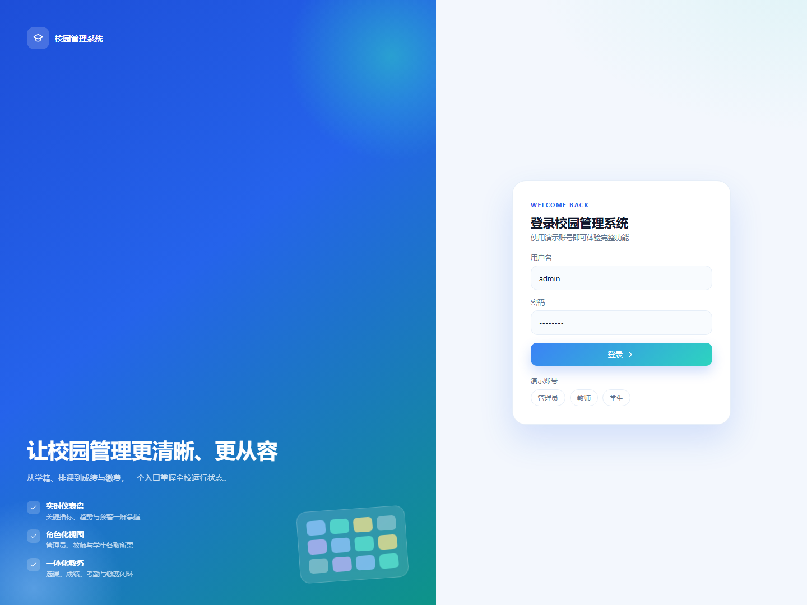

# campus-ms 校园管理系统

基于 **FastAPI + SQLite** 的校园管理系统，前后端分离：后端只提供 `/api/v1` JSON API，
前端是无构建步骤的原生 JS 静态页面（由 FastAPI 托管）。

## 功能

| 模块 | 能力 |
| --- | --- |
| 认证 | 用户名/密码登录、JWT 鉴权、修改密码、三角色（admin/teacher/student） |
| 权限 | 权限点入库、角色授权与用户级覆盖、数据范围（全校/本班/本人）、字段脱敏、`/auth/me` 下发导航 |
| 学生 | 学号/姓名/性别/学籍状态/班级/座位/监护人/联系方式，检索、分页、启停用、成绩单 |
| 教师 | 工号/姓名/职称/学科/职务/入职/在职状态/学历/办公室/课时上限，检索、分页、启停用 |
| 班级 | 名称/年级/院系/专业/教室/容量/班主任 |
| 组织 | 院系与处室、学科目录、学期设置与当前学期切换 |
| 课程 | 课程代码/学分/学时/学期/任课教师/容量，多教师、面向班级、课程类型与考核方式 |
| 选课 | 学生自助选课/退课、容量与重复校验、退课锁定 |
| 成绩 | 平时/期中/考试按课程权重合成总评、批量录入、发布/撤回 |
| 考勤 | 按课程+日期+节次登记（出勤/迟到/缺勤/请假） |
| 课表 | 按星期/节次排课，行政班与调课/停课审批 |
| 宿舍 | 楼栋/房间/床位，分配与退宿，容量与性别校验 |
| 缴费 | 费用项/金额/截止日期，缴费状态与支付 |
| 请假 | 学生/教师申请，两级审批（班主任→学工处 / 教务主任→管理员），通过后考勤联动 |
| 通知 | 全校/教师/学生/班级四类受众，置顶与过期 |
| 座位 | 班级座位表网格、按顺序排座、座位冲突校验 |
| 学籍 | 在读/休学/退学/毕业/保留学籍变更与异动时间线 |
| 审计 | 写操作留痕、导出记录、管理员日志查询 |
| 账号 | 账号启停用、重置密码 |
| 导入导出 | 学生/成绩/考勤 CSV 导出，学生 CSV 导入 |
| 仪表盘 | 角色化 KPI、考勤趋势、成绩分布、费用收缴、课程饱和度、班级对比、预警待办与最近动态 |
| 报表 | 教师工作量、学科成绩分析、班级出勤/收缴对比 |
| 界面 | 明亮校园风、浅色侧栏、本地 ECharts 图表、骨架屏、Ctrl+K 功能搜索、移动端适配 |

## 界面预览

| 登录 | 管理员仪表盘 |
| --- | --- |
|  |  |

| 学生仪表盘 | 移动端 |
| --- | --- |
|  |  |

## 快速开始

要求 Python 3.11+（开发基线 3.12）。

```powershell
python -m venv .venv
.\.venv\Scripts\Activate.ps1
python -m pip install -U pip
pip install -e ".[dev]"

# 生成演示数据（可重复执行，不会重复插入）
python -m campus.db.seed

# 启动
python -m uvicorn campus.main:app --reload --port 8000
```

打开 <http://127.0.0.1:8000/> 使用网页界面，或访问 <http://127.0.0.1:8000/docs> 查看 OpenAPI 文档。

### 演示账号

| 角色 | 用户名 | 密码 |
| --- | --- | --- |
| 管理员 | `admin` | `admin123` |
| 教师 | `t001` … `t005` | `teacher123` |
| 学生 | `s001` … `s030` | `student123` |

> 演示密码仅用于本地开发，正式部署前必须修改。
>
> 管理员登录后可在「系统设置」调整角色权限、院系、学科与学期；授权即时生效。
> 内置岗位角色 `student_affairs`（学工处）与 `academic_director`（教务主任）用于请假审批，可后台分配给教师账号。

## 常用命令

```powershell
python -m compileall -q src          # 语法检查
ruff check .                         # 静态检查
ruff format --check .                # 格式检查
mypy src                             # 类型检查
pytest --cov=campus                  # 测试与覆盖率

alembic upgrade head                 # 应用数据库迁移
python scripts/dev.ps1               # 一键安装依赖 + 建库 + 启动
```

## 目录

```text
src/campus/
├── main.py           应用工厂（CORS、异常处理、静态托管、生命周期）
├── core/             配置、安全、异常、分页、日志
├── db/               引擎与会话、建表、种子数据
├── models/           SQLAlchemy 2.0 ORM
├── schemas/          Pydantic v2 契约
├── repositories/     数据访问
├── services/         业务规则与权限
├── api/v1/           路由
└── web/              静态前端
```

工程规范见 [AGENTS.md](AGENTS.md)，架构说明见 [docs/ARCHITECTURE.md](docs/ARCHITECTURE.md)，
接口清单见 [docs/API.md](docs/API.md)。

## 配置

复制 `.env.example` 为 `.env` 后按需修改；生产环境必须设置强随机 `JWT_SECRET` 且长度不少于 32 位。
